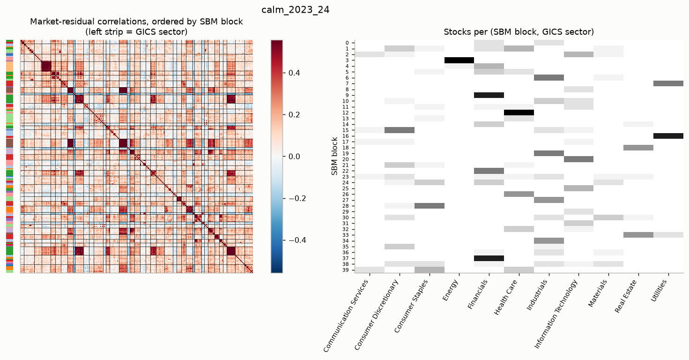
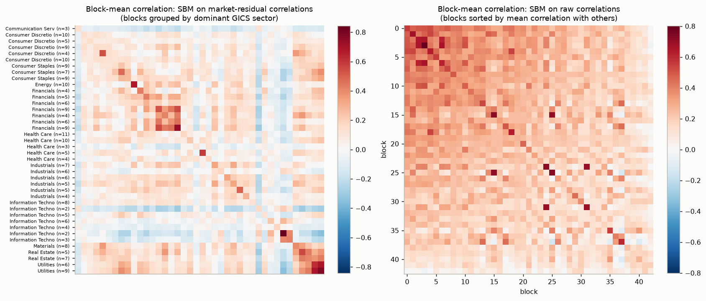
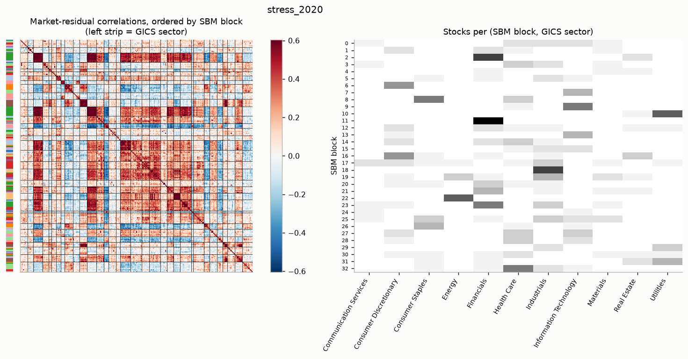
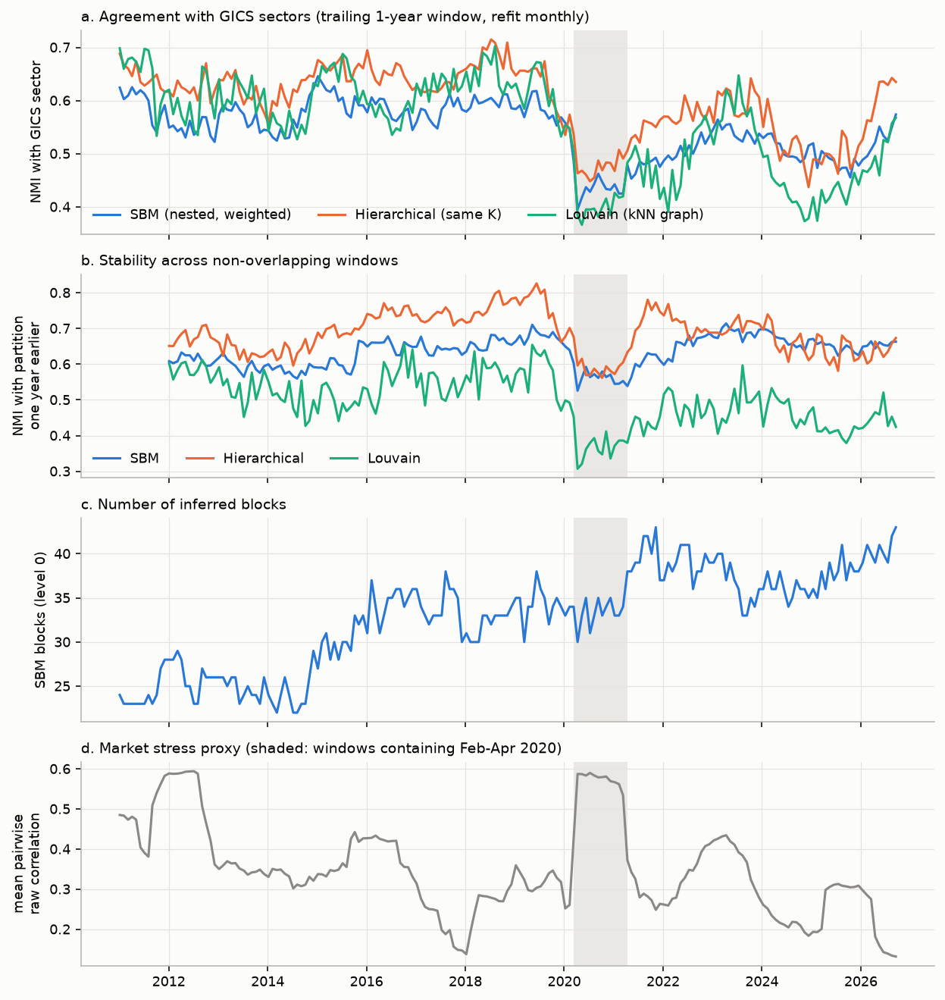
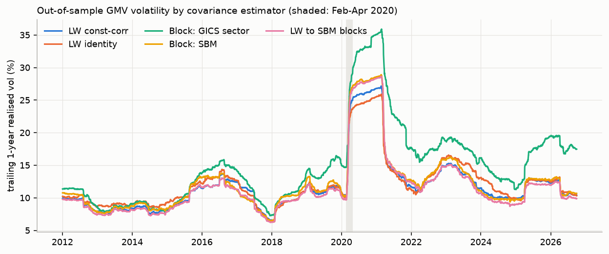

# Stochastic block models of S&P 500 correlation networks

Bayesian stochastic block models (SBMs) fitted to market-residual correlation networks of 250 large US stocks, 2010–2026: what structure they find beyond GICS sectors, how it changes in the 2020 crash, and whether it helps minimum-variance portfolios.

## Abstract

Stocks that move together are usually grouped by industry labels such as GICS sectors. This project asks whether a principled statistical model of the co-movement network finds a different grouping, and whether that grouping is useful for risk.

After removing the market factor, the correlation matrix of 250 S&P 500 stocks is treated as a dense weighted graph and fitted with nested, weighted Bayesian SBMs in [graph-tool](https://graph-tool.skewed.de/). The number of groups and the model variant are chosen by minimum description length (DL).

- **Structure.** The SBM finds about 30–40 blocks (median 34 over 189 rolling windows). They are much closer to GICS *sub-industries* than to sectors. Roughly half of the blocks are **not assortative**: their stocks correlate more with some other block than with each other. The assortative-only planted-partition model is rejected by more than 260 nats of description length.
- **Stress.** In 2020 the blocks reorganise across sector lines, forming "reopening/travel", "stay-at-home" and mega-cap technology blocks. Sector alignment, the share of assortative blocks and month-to-month stability all drop in windows that contain the crash. Hierarchical and Louvain clusterings show the same drop.
- **Risk.** As a Ledoit–Wolf shrinkage target, the SBM blocks give global minimum-variance (GMV) volatility of 12.37% against 12.42% for constant-correlation Ledoit–Wolf (ratio 0.996, 95% CI [0.962, 1.028]). This is an **honest near-null**. As a pure block covariance model, the SBM partition beats GICS-sector, hierarchical and Louvain partitions by 10–20%, but no pure block model is competitive with Ledoit–Wolf.

The toolkit (graph-tool, MCMC, model selection by description length) comes from my postdoctoral work fitting SBMs to ecological food webs. This project applies it to financial data.

## Contents

1. [Data](#1-data)
2. [Method](#2-method)
3. [Results: structure](#3-results-structure)
4. [Results: 2020 stress and rolling stability](#4-results-2020-stress-and-rolling-stability)
5. [Results: minimum-variance backtest](#5-results-minimum-variance-backtest)
6. [Limitations](#6-limitations)
7. [Reproduce](#7-reproduce)
8. [Repository layout](#8-repository-layout)

## 1. Data

| Source | What |
|---|---|
| Wikipedia, *List of S&P 500 companies* (`requests` + `pandas.read_html`) | Current constituents with ticker, GICS sector, GICS sub-industry and date added |
| Yahoo Finance via [`yfinance`](https://github.com/ranaroussi/yfinance) (`auto_adjust=True`) | Daily adjusted close and volume, 2010-01-04 to 2026-09-30, for all constituents plus SPY |

**No market data is included in this repository.** Yahoo Finance data may not be redistributed, so `scripts/01_download.py` downloads it to a local cache (`data/`, gitignored). The results in `results/` were produced from a download made on 2026-10-13.

**Universe** (`src/data.py::select_universe`):

1. Keep only firms that were already in the index on 2010-01-01. This removes firms that joined later *because* they grew, which is the worst form of look-ahead bias in a current-constituent list.
2. Require a complete price history.
3. Rank by mean dollar volume over the first 252 trading days only, and keep the top 250.

This gives Financials 45, Industrials 38, Health Care 32, IT 29, Consumer Discretionary 26, Consumer Staples 20, Utilities 17, Real Estate 13, Materials 12, Energy 11 and Communication Services 7.

## 2. Method

### 2.1 Removing the market mode

Raw correlations are dominated by one market factor. The mean pairwise correlation is 0.33 in calm windows and 0.55 in windows containing the 2020 crash. Two treatments are compared with raw correlations (`src/preprocess.py`):

- **SPY residuals:** OLS regression of each stock on SPY, with an intercept, within the window.
- **PC1 removal:** standardise the returns and subtract the projection on the first principal component.

The two give similar partitions. NMI with GICS sectors is 0.556 (SPY) against 0.561 (PC1) in 2023–24, and 0.423 against 0.445 in 2020. SPY residuals are used downstream because the factor is observable and simple to explain.

### 2.2 Network construction

- **Dense weighted graph (main model).** The complete graph on 250 nodes (31,125 edges), with each edge's residual correlation stored as a `real-normal` edge covariate (`gt.WeightedBlockState`). Nothing is thresholded, so there is no threshold or *k* to tune. Because every pair is connected, all of the signal is in the weights. For the same reason degree correction is redundant (every degree is 249), and the DL confirms this.
- **Sparsified kNN graph.** Each stock links to its k = 10 most correlated peers (union of neighbour lists, about 1,850 edges). This graph serves as a robustness check and allows the test against the **planted-partition** model (`gt.PPBlockState`), which graph-tool defines only for unweighted graphs.

### 2.3 SBM variants and model selection

Each fit (`src/sbm.py`):

1. runs `minimize_blockmodel_dl` (flat) or `minimize_nested_blockmodel_dl` (nested) from several restarts (5 in the pilot, 3 in the rolling analysis);
2. polishes each result with zero-temperature merge-split sweeps (`multiflip_mcmc_sweep(beta=inf)`);
3. keeps the partition with the lowest description length.

Variants are flat or nested, degree-corrected (DC) or not (NDC), weighted or unweighted, and general or planted-partition (assortative only). Thirteen variants are fitted per pilot window, covering three market treatments and both graph types.

Models are compared by **description length** in nats, where a lower DL means better compression and a difference ΔDL corresponds to a posterior odds ratio of e^ΔDL. DLs are compared **only on the same data and the same graph**. DLs of weighted and unweighted models, or of graphs built differently, are not comparable. Weighted DLs can be negative because they include the differential entropy of continuous weights.

### 2.4 Baselines and comparison measures

- **Partitions:** GICS sector (11 groups) and sub-industry (95); Louvain (networkx, seeded) on the dense positive-weight graph and on the kNN graph; average-linkage hierarchical clustering on the distance √(2(1−ρ)), cut at K = 11 and at K = B_SBM.
- **Similarity:** NMI and ARI. NMI depends on the number of groups, so comparisons are made at matched K where possible.
- **Compression:** the DL of each baseline partition under the *same* weighted SBM (`compare.dl_of_partition`), reported as ΔDL relative to the SBM partition.
- **Mixing pattern:** the block-mean correlation matrix ω_rs. A block of two or more stocks is called *assortative* if ω_rr > max over s ≠ r of ω_rs.

## 3. Results: structure

Pilot windows: calm, 2023-01-01 to 2024-12-31 (502 days), and stress, calendar 2020 (253 days).

### 3.1 Model selection

ΔDL in nats (lower DL wins). Each row compares models on the same graph and the same SPY-residual data. Source: `results/pilot_model_selection.csv`.

| Comparison | 2023–24 | 2020 |
|---|---|---|
| Dense: nested beats flat (NDC) by | 561 | 346 |
| Dense: NDC beats DC by | 294 | 234 |
| kNN: general SBM (DC) beats **assortative planted-partition** (DC) by | 266 | 263 |
| kNN: weighted nested beats weighted flat (DC) by | 130 | 71 |

The **nested, weighted, non-degree-corrected SBM on the dense graph** is preferred in every setting, including raw and PC1-removed correlations, and is used downstream.

On the kNN graph the planted-partition model is rejected by more than 260 nats, which corresponds to posterior odds of about e²⁶⁰. The planted-partition model also forces every between-group rate to be equal. Its rejection therefore says that "assortative communities against one uniform background" is too simple, but does not by itself prove that the groups are non-assortative. The block-level analysis below tests that separately.

### 3.2 Partitions, 2023–24

Source: `results/pilot_partitions_calm_2023_24.csv`.

| Partition | K | NMI vs GICS sector | ARI vs GICS sector | ΔDL vs SBM (nats) | Share of blocks assortative |
|---|---|---|---|---|---|
| SBM (nested, level 0) | 40 | 0.556 | 0.175 | 0 | 0.53 |
| SBM nested level 1 | 9 | 0.341 | 0.143 | +9,900 | 0.44 |
| GICS sector | 11 | 1 | 1 | +14,819 | 0.64 |
| GICS sub-industry | 95 | 0.687 | 0.177 | +22,907 | 0.73 |
| Louvain (kNN graph) | 8 | 0.510 | 0.302 | +13,503 | 1.00 |
| Hierarchical, K = 40 | 40 | 0.591 | 0.305 | +14,482 | 1.00 |

- **SBM blocks resemble GICS sub-industries, not sectors.** NMI is 0.757 against sub-industries and 0.556 against sectors. Many blocks are clean industry groups: energy (10 stocks, mean within-block residual correlation 0.67), regional banks (9, 0.73), utilities (9, 0.77), AMAT/KLAC (0.84), life-science tools (A, DHR, RVTY, TMO, WAT; 0.59), defence primes (GD, LHX, LMT, NOC, RTX; 0.50) and homebuilders (DHI, LEN, PHM, with EXPD; 0.54).
- **About half of the blocks are not assortative.** They fall into two types:
  - *Satellite blocks*, defined by a shared pattern of correlation with a core block. Examples are a second utilities block (CNP, ETR, EXC, FE, PEG, XEL: 0.62 internally but 0.69 with the core utilities block); brokers, custodians and life insurers (0.53 internally, 0.55 with regional banks); and a cross-sector rate-sensitive block (AES, AMT, NEE, PSA, VTR, WELL: 0.40 internally, 0.44 with utilities). This is core–periphery structure inside sectors.
  - *Low-correlation residual blocks* (internal correlation about 0.1–0.17, mixed sectors, for example BA, CCL, DIS, EXPE, FDX, HPQ, MAR, RL, TPR, WYNN). The real-normal SBM groups these stocks because their correlation *distributions* look alike (near zero, low variance), not because they co-move.
- **The coarse level of the hierarchy is not sector-like** (NMI 0.34 at level 1). One level-1 group contains all 10 energy stocks and 18 financials; another combines utilities, staples, health care and REITs. This is consistent with value or rate and defensive style factors, but has not been tested against factor returns.
- **Compression.** Every baseline partition compresses the data much worse under the same model, by 9,900–22,900 nats. Part of this is expected, because the SBM partition optimises this objective. Hierarchical clustering at the same K = 40 is still 14,482 nats worse.
- **Without market removal**, the block matrix is close to rank one. The correlation of ω_rs with c_r·c_s (c_r is block r's mean correlation with everything else) is 0.76 in 2023–24 and 0.89 in 2020. The dominant between-block pattern is then core–periphery, with blocks differing mainly in market sensitivity.





## 4. Results: 2020 stress and rolling stability

### 4.1 The 2020 window

The SBM fitted to calendar 2020 (33 blocks) finds clear sector-crossing blocks:

- a **"reopening/travel" block**: BA, CCL, DRI, EXPE, HIG, MAR, SPG, SYY, VTR, WELL, WYNN, spanning five GICS sectors, with internal residual correlation 0.55;
- a **"stay-at-home" block**: AKAM, AMGN, CLX, COST, KR, WMT;
- a **mega-cap technology block**: AAPL, ADBE, AMZN, MSFT, NVDA.

At level 1, one super-group combines 26 financials, 11 industrials, 9 consumer discretionary stocks, 6 REITs and 4 energy stocks, and its NMI with sectors is 0.18. Large anti-correlated block pairs appear in the residual correlation matrix.



### 4.2 Rolling analysis

The chosen model is refitted every 21 trading days from 2011-01-04 to 2026-09-30 (189 windows), each time on the trailing 252 days. Louvain and hierarchical clusterings are fitted on the same windows. Stability is the NMI between partitions one month apart (about 92% data overlap) and one year apart (no data overlap). Source: `results/stability_summary.json`.

| | SBM | Hierarchical (K = B) | Louvain (kNN) |
|---|---|---|---|
| Mean NMI with GICS sector | 0.545 ± 0.052 | 0.598 ± 0.065 | 0.554 ± 0.091 |
| Mean NMI with the partition 1 month earlier | 0.824 | 0.878 | 0.757 |
| Mean NMI with the partition 1 year earlier | 0.634 | 0.687 | 0.499 |

- The number of blocks ranges from 22 to 43 (median 34) and **trends upwards**, from about 25 in 2011–14 to about 40 in 2022–26. The cause is not identified. Candidates are richer residual structure, a lower market correlation exposing more detail, or the fixed universe ageing.
- **The 2020 reorganisation is real but not specific to the SBM.** Windows containing the February–April 2020 crash have lower sector alignment (NMI 0.44 against 0.55 elsewhere), a smaller share of assortative blocks (0.48 against 0.57), and lower month-to-month stability as the crash enters the window (NMI 0.73 against 0.82 on average). Hierarchical and Louvain clusterings show the same dip. Sector alignment recovers from 2021.
- **The SBM is less stable than hierarchical clustering at the same K, but much more stable than Louvain.** Some of the SBM's instability is likely optimiser noise (see [Limitations](#6-limitations)).



## 5. Results: minimum-variance backtest

**Design.** At each of the 189 rebalance dates, estimate a covariance matrix from the trailing 252 days of daily log returns, form GMV weights (w ∝ Σ⁻¹1, shorts allowed) and hold them for 21 days. Partitions come from the same trailing window, so there is no look-ahead. The metric is annualised realised volatility over 3,958 out-of-sample days. Uncertainty comes from a 95% circular block bootstrap (21-day blocks, 2,000 draws) on paired volatility ratios.

**Estimators** (`src/covariance.py`, tested in `tests/test_covariance.py`):

| Estimator | Description |
|---|---|
| Sample | `np.cov` |
| LW identity | Ledoit–Wolf (2004a) shrinkage towards a scaled identity (scikit-learn) |
| LW const-corr | Ledoit–Wolf (2004b) shrinkage towards constant correlation, implemented here and checked against a loop transcription of the paper's formulas |
| Block: *partition* | Sample variances with block-averaged correlations (each r_ij replaced by the mean correlation between the blocks of i and j) |
| LW to *partition* blocks | Ledoit–Wolf shrinkage towards the block target, using the same optimal-intensity formula with block-pair average correlations in place of the single average |

**Results.** Annualised volatility in %. The last column is the ratio to LW const-corr with its 95% block-bootstrap CI. Source: `results/backtest_summary.csv`; head-to-head comparisons are in `results/backtest_pairwise.csv`.

| Estimator | Full | 2011–19 | 2020 | 2021–26 | Turnover | Gross leverage | Ratio to LW-CC [95% CI] |
|---|---|---|---|---|---|---|---|
| **LW to SBM blocks** | **12.37** | **9.55** | 28.29 | **11.70** | 2.19 | 4.56 | 0.996 [0.962, 1.028] |
| LW const-corr | 12.42 | 9.91 | 26.75 | 12.00 | 2.06 | 5.24 | 1 |
| LW to GICS-sector blocks | 12.45 | 9.60 | 28.44 | 11.78 | 1.81 | 4.89 | 1.002 [0.971, 1.030] |
| LW identity | 12.60 | 10.29 | **25.47** | 12.50 | 2.84 | 6.10 | 1.015 [0.981, 1.049] |
| Block: GICS sub-industry | 12.67 | 9.86 | 27.27 | 12.56 | 1.42 | 4.37 | 1.020 [0.992, 1.053] |
| Block: SBM | 12.94 | 10.22 | 28.53 | 12.37 | 1.96 | 3.84 | 1.042 [1.011, 1.068] |
| Block: hierarchical (K = B) | 14.39 | 10.83 | 32.43 | 14.14 | 1.27 | 3.45 | 1.158 [1.114, 1.201] |
| Block: SBM level 1 | 15.11 | 11.57 | 32.30 | 15.30 | 1.67 | 3.28 | 1.217 [1.175, 1.258] |
| Block: Louvain kNN | 15.24 | 11.22 | 34.33 | 15.27 | 1.08 | 3.21 | 1.227 [1.181, 1.271] |
| Block: GICS sector | 16.13 | 11.63 | 35.02 | 16.94 | 0.46 | 3.18 | 1.299 [1.216, 1.397] |
| Sample | 128.0 | 111.8 | 146.2 | 147.0 | 130 | 90 | 10.3 |

- **The headline comparison is a near-null.** Shrinking towards SBM blocks gives 12.37% against 12.42% for constant-correlation Ledoit–Wolf: ratio 0.996, CI [0.962, 1.028]. It also does not beat shrinkage towards GICS-sector blocks (ratio 0.994, CI [0.972, 1.013]).
- **Block targets help in 2011–19 and hurt in 2020.** In 2011–19, SBM and GICS-sector block targets both beat constant correlation, by 3.6% (CI [0.943, 0.984]) and 3.1% respectively, and are indistinguishable from each other. During the 2020 crash every block target did worse than the simple targets.
- **Among pure block models, the SBM partition is the best data-driven partition.** Its volatility is 20% lower than GICS sectors (ratio 0.80, CI [0.74, 0.87]), 10% lower than hierarchical clustering at the same K (0.90 [0.87, 0.93]) and 15% lower than Louvain (0.85 [0.82, 0.88]). It is indistinguishable from the 95-group GICS sub-industry partition (1.02 [0.98, 1.05]). No pure block model is competitive with Ledoit–Wolf.
- With T = 252 and N = 250 the sample covariance is nearly singular, so its 128% volatility is a degenerate reference, not a meaningful baseline.

The sub-periods were fixed in the script before results were seen, but eleven estimators and four periods make many comparisons, so sub-period results should be read as exploratory.



## 6. Limitations

- **Survivorship bias.** The constituent list is today's, so firms that left the S&P 500 between 2010 and 2026 are missing. Restricting the universe to firms already in the index on 2010-01-01, and ranking liquidity only on the first year, removes the worst look-ahead (firms that entered because they grew) but not the bias itself. The likely effect is a less volatile universe than the true investable set, so absolute GMV volatilities are biased down. Relative comparisons between estimators should be less affected. A point-in-time constituent list would remove the bias.
- **Optimiser uncertainty, not posterior uncertainty.** Every partition is a MAP point estimate from a heuristic optimiser, not a sample from the posterior. Single restarts reach DLs up to about 200 nats apart, so the rolling stability numbers mix real structural change with optimiser noise. Posterior sampling (`mcmc_equilibrate`) and partition-mode summaries (`gt.ModeClusterState`) would separate the two.
- **graph-tool seed 0.** In graph-tool, `seed_rng(0)` means "seed from system entropy", not "use seed 0". An early run used seed 0 and was silently non-deterministic. The code now defaults to seed 42 and raises an error on seed 0. Fits run with one OpenMP thread per process and reproduce exactly from run to run. The unseeded run gave numbers within about 1% of the seeded run, which is an informal robustness check.
- **"Noise bucket" blocks.** The real-normal weight model groups weakly correlated stocks because their correlation distributions look alike, which lowers the assortative share for reasons unrelated to economics. A Fisher-z transform or a different weight distribution may behave differently.
- **Crude assortativity criterion.** Comparing block means is noisy for blocks of 2–3 stocks, and has no formal test.
- **NMI depends on the number of groups.** Comparisons are made at matched K where possible. Adjusted or reduced mutual information would be more robust.
- **Labels and data quality.** GICS labels are today's and are applied to all of history (for example the 2023 move of V and MA to Financials), which slightly favours the GICS baselines in early years. A few unadjusted spin-off jumps remain in the Yahoo data (for example DHR on 2016-07-05 and EXPE on 2011-12-21).
- **Style-factor reading of level-1 groups** is a hypothesis that has not been tested against factor returns.

## 7. Reproduce

### Environment

graph-tool is not on PyPI; install it from **conda-forge**. `environment.yml` pins the versions used for the results (Python 3.12, graph-tool 3.9, numpy 2.5, pandas 3.0, scikit-learn 1.9, networkx 3.7, yfinance 1.7.0).

```bash
git clone <repo-url> sbm-equity-networks
cd sbm-equity-networks
conda env create -f environment.yml      # uses the conda-forge channel
conda activate sbm-corr
```

### Pipeline

Run from the repository root. Times are for a 16-core machine; the full pipeline takes about 25 minutes plus the download.

```bash
python tests/test_covariance.py          # < 10 s: estimator unit tests
python scripts/01_download.py            # ~2 min: Wikipedia + yfinance -> data/ (cached)
python scripts/02_pilot.py --refit       # ~5 min: 26 SBM fits, pilot tables and figures
python scripts/03_rolling_fits.py        # ~18 min: SBM, Louvain and hierarchical fits on 189 windows
python scripts/04_stability.py           # ~1 min: stability metrics, figures/rolling_stability.png
python scripts/05_backtest.py            # ~15 s: GMV backtest, figures/backtest_rolling_vol.png
```

Notes:

- `01_download.py` fetches the *current* S&P 500 list from Wikipedia and the price history from Yahoo. Both change over time (index membership changes, Yahoo revises adjusted prices), so a fresh download can select a slightly different universe and give numbers that differ from those in `results/`. Run `02_pilot.py` with `--refit` and rerun `03_rolling_fits.py` after a fresh download, because the cached fits in `results/` refer to the universe of the original download.
- Without `--refit`, `02_pilot.py` reuses `results/pilot_fits.json` and only rebuilds the tables and figures.
- To keep the data cache outside the repository, set `SBM_DATA_DIR=/path/to/cache` before running any script.
- SBM fits are seeded (seed 42, one OpenMP thread per process). On the same data they reproduce exactly.
- `05_backtest.py` runs in about 15 s on an idle machine. If other jobs are using the CPU, multithreaded BLAS can slow it down badly; `OMP_NUM_THREADS=1 python scripts/05_backtest.py` avoids this.
- `05_backtest.py` also writes the daily portfolio returns to `results/gmv_daily_returns.parquet`. That file is derived from Yahoo prices and is gitignored.

## 8. Repository layout

```
src/data.py          constituents (Wikipedia), prices (yfinance), universe selection
src/preprocess.py    log returns -> SPY residuals / PC1 removal
src/network.py       dense and kNN graph-tool graphs
src/sbm.py           seeded SBM fits (flat / nested / weighted / planted-partition)
src/compare.py       Louvain, hierarchical clustering, NMI/ARI, DL of a fixed partition, mixing summaries
src/covariance.py    sample, Ledoit-Wolf (identity, const-corr, block target), block model, GMV weights
src/plotting.py      shared figure style
scripts/01..05       pipeline steps (see Reproduce)
tests/               estimator checks, including LW const-corr against a loop transcription of the paper
results/             partitions (JSON), summary tables (CSV/JSON) and run logs
figures/             PNG figures used in this README
```

---

Developed with AI assistance (Claude Code).
