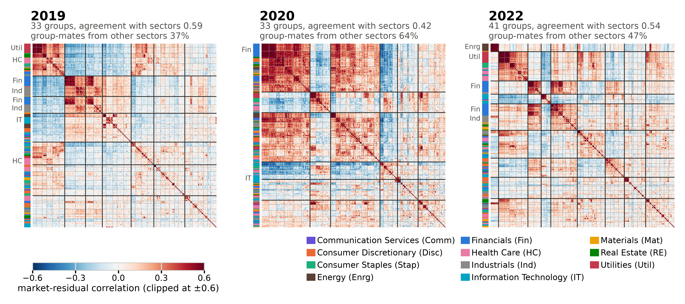
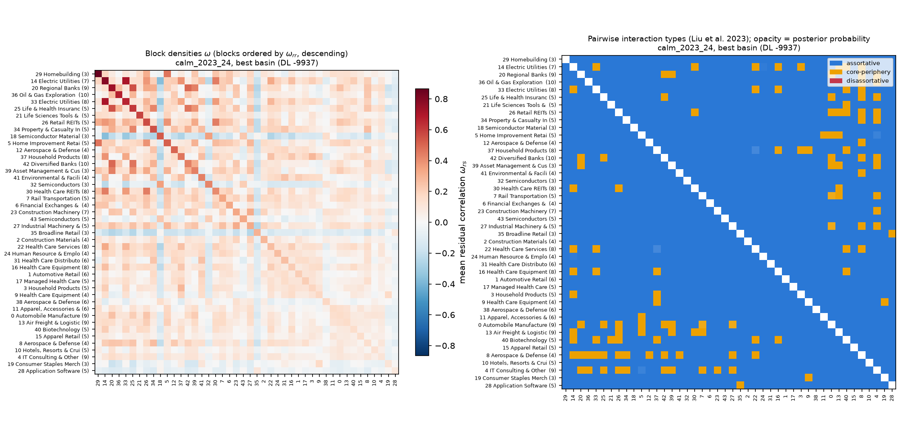
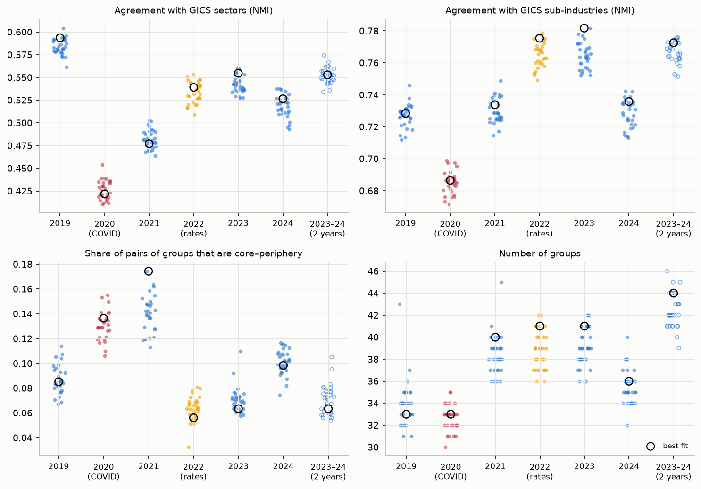
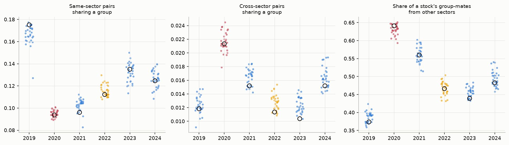
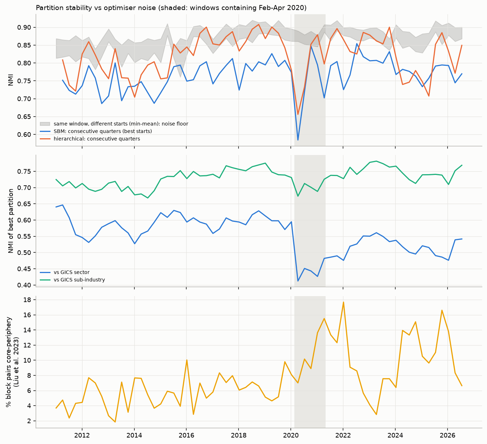

# Beyond sectors: stochastic block models of US stock co-movement

Which groups of large US stocks move together once the market is removed, how those groups changed in the 2020 crash and the 2022 rate rise, and whether they help build lower-risk portfolios. Daily returns of 250 S&P 500 stocks, 2010–2026.

## Summary

Investors usually group stocks by industry labels such as GICS sectors. This project asks what groups the data themselves suggest. It measures how closely 250 large US stocks move together after removing the movement of the market as a whole, and fits a **stochastic block model** (SBM) to the resulting network with [graph-tool](https://graph-tool.skewed.de/).

An SBM is a statistical model of how the network could have arisen: each stock belongs to a group, and how closely two stocks move together depends only on their groups. Unlike most clustering methods, it does not assume that groups are tight communities. A group can also be defined by how it relates to the rest of the market. Because it is fitted in a Bayesian way, it weighs fit against complexity, so it does not report groups that the data cannot support and it chooses the number of groups itself.

Four questions, with short answers:

1. **What groups does the model find?** A few dozen groups that refine sectors to roughly the sub-industry level: utilities, regional banks, oil producers, defence primes, semiconductor equipment and so on.
2. **How are the groups related?** Almost all pairs of groups behave as communities: each group is tighter internally than with the other. The exceptions that matter are in the utilities, banks and real-estate complexes, where a looser group is tied more closely to a tighter neighbour than to itself (a *core–periphery* pair).
3. **How did the groups change in the 2020 crash and the 2022 rate rise?** COVID regrouped stocks *across* sectors, by their exposure to lockdowns and reopening; the share of a stock's group-mates from other sectors rose from 39% in 2019 to 63% in 2020. The 2022 rate rise did not: groups stayed within sectors (47%), and energy became one tight group. The old structure has only partly returned.
4. **Do the groups help build lower-risk portfolios?** A little. Shrinking the covariance matrix towards the groups gives about 4% lower out-of-sample volatility than standard constant-correlation shrinkage, and about 2% lower than shrinking towards sectors. It is a modest gain, not a reliable edge.

A longer paper-style write-up is available separately. The toolkit comes from my postdoctoral work fitting SBMs to ecological food webs.



*Each row and column is one stock, in the same order on both axes; red cells are pairs that moved together beyond the market, blue cells pairs that moved oppositely. Each group is a square on the diagonal. The strips give each stock's sector: long single-colour stretches are one-sector groups. In 2019 the upper half of the strip is mostly such stretches; in 2020 sectors mix; in 2022 the stretches return.*

## Data

Daily adjusted closes from Yahoo Finance (via [`yfinance`](https://github.com/ranaroussi/yfinance)), 4 January 2010 to 30 September 2026, with sectors and sub-industries from the current Wikipedia list of S&P 500 companies. **No market data is included in this repository**; `scripts/01_download.py` downloads it to a local cache (`data/`, gitignored).

The universe is the 250 most liquid stocks, ranked on their first year only, among firms that were already in the index on 1 January 2010 and have a complete price history (`src/data.py`). This avoids picking firms that later joined the index *because* they grew, but it does not remove survivorship bias (see Limitations).

## Method

* **Removing the market.** Raw correlations are dominated by the market: everything moves with it. For each stock and each window, the daily return is regressed on the S&P 500 ETF (SPY) and only the residual is kept (`src/preprocess.py`). Removing the first principal component instead gives similar groups.
* **The network.** The residual correlations form a complete weighted network: every pair of stocks is linked, with the correlation as the link's weight. Nothing is thresholded (`src/network.py`).
* **The model.** A nested, weighted SBM, which groups the stocks and then groups the groups (`src/sbm.py`). It was chosen over 12 other versions, including a version that only allows communities, by minimum description length: the model that describes the data most compactly wins. This choice held on every test window and every way of handling the market.
* **Fitting.** The model has many good solutions of almost equal quality, and a single fit ends in one of them. Each calendar year is therefore fitted 30 times from independent starts, and each quarterly window 8 times (`scripts/08_basin_search.py`, `scripts/12_rolling_basins.py`). The results describe the best fit of each window, with ranges across fits where they matter.
* **How pairs of groups relate.** Following [Liu, Alexander & Altmann (2023)](https://doi.org/10.1093/pnasnexus/pgad364), each pair of groups is classified by comparing the average correlation inside each group with the average correlation between them: a **community** pair if the between-group correlation is the lowest, **core–periphery** if it lies between the two within-group values, and **disassortative** if it is the highest (`src/interactions.py`).
* **Windows.** The calendar years 2019–2024, the two calm years 2023–24 together, and rolling one-year windows refitted every quarter from 2011 to 2026.
* **Portfolio test.** Every quarter, a minimum-variance portfolio is built from the trailing year of returns, with Ledoit–Wolf shrinkage of the covariance matrix towards a target built from the model's groups (`src/covariance.py`, tested in `tests/test_covariance.py`). Its realised volatility over 2011–2026 is compared with shrinkage towards constant correlation and towards sectors, with 95% block-bootstrap intervals.

## Results

**Robustness.** Repeated fits of the same window end at slightly different groupings, but these are very similar: in 2023–24 every fit agrees closely with the best one (NMI of at least 0.89), and every statistic reported here holds in every fit. All results below are from these repeated fits ([`results/posterior/`](results/posterior/)).

**The groups refine sectors.** The best 2023–24 fit has 44 groups. Its agreement with GICS sectors is moderate (NMI 0.55) and with sub-industries much higher (0.77). Many groups are clean industry groups; others mix industries that share an exposure, such as interest-rate-sensitive utilities and REITs ([`results/posterior/baselines.csv`](results/posterior/baselines.csv)).

**Almost all pairs of groups are communities.** In the best 2023–24 fit, 94% of pairs of groups are community pairs, 6% core–periphery and none disassortative. Most core–periphery margins are small; the substantive ones are in the utilities, banks and REIT complexes.



**2020 broke the link between groups and sectors; 2022 did not.** Agreement with sectors fell from 0.56–0.60 in 2019 to 0.41–0.45 in 2020 (ranges across fits), lower than any fit of any other year. This holds for every fit and for one-year as well as two-year windows. In 2020 one group held travel and reopening stocks from five sectors (BA, CCL, MAR, EXPE, WYNN and others), another held stay-at-home stocks (COST, WMT, KR, CLX), and a large set of financial, travel, energy and cyclical stocks moved against technology. Averaged over fits, the share of a stock's group-mates from other sectors rose from 39% in 2019 to 63% in 2020. In 2022 it was 47%, close to 2019: the change came within sectors, and energy became a single tight group (10 of its 11 stocks) that has stayed together since. Agreement with sectors has not returned to its 2019 level, but groups are also finer after 2020, which lowers within-sector agreement partly mechanically.





**The 2020 break also shows in the quarterly refits.** Agreement with sectors is 0.53–0.65 in every window ending 2011–2019 and falls to 0.41 when the crash enters the window. Two fits of the same window agree to NMI 0.89 on average, while best fits in consecutive quarters agree to 0.77: about half of the apparent quarter-to-quarter change is fitting noise, not market change.



**The groups help portfolios a little.** With quarterly rebalancing, shrinking towards the model's groups gives volatility ratios of 0.958 [0.941, 0.981] against constant-correlation shrinkage and 0.978 [0.959, 0.995] against shrinking towards sectors. Does the quality of the fit matter? Groups from quicker, less thorough fits on the same dates already beat constant correlation (0.974), but not sectors (0.995 [0.965, 1.016]): the small edge over sectors needs the better fits. The direct step from quicker to better fits, 0.983 [0.966, 1.004], is not clearly different from zero ([`results/backtest_pairwise_quarterly.csv`](results/backtest_pairwise_quarterly.csv), [`results/partition_effect.csv`](results/partition_effect.csv)).

## Limitations

* **Survivorship bias.** The constituent list is today's, so firms that left the index between 2010 and 2026 are missing. The universe is likely less volatile than the true investable set, so absolute portfolio volatilities are biased down; comparisons between methods should be less affected.
* **The test design was not fixed in advance.** A monthly version of the portfolio test showed no gain (ratio 0.996 [0.962, 1.028]); the quarterly design was chosen after that. With eleven methods and several periods there are many comparisons.
* **Fitting.** No search is guaranteed to find the best possible grouping, so results are reported as ranges across fits, and 8 fits per quarterly window leave each rolling point noisy.
* **Small core–periphery margins.** Most core–periphery pairs rest on differences of a few hundredths of a correlation.
* **Weakly correlated stocks.** The weight model groups weakly correlated stocks together because their correlations look alike (near zero), not because they move together. A different weight model may behave differently.
* **NMI depends on the number of groups**, and there are more groups after 2020, so changes in agreement with sectors are partly mechanical.
* **Labels and data.** GICS labels are today's and are applied to all of history. A few unadjusted spin-off jumps remain in the Yahoo data.
* **The coarser level of the hierarchy** looks like style groupings (value, rates, defensives), but this has not been tested against factor returns.

## Reproduce

### Environment

graph-tool is not on PyPI; install it from **conda-forge**. `environment.yml` pins the versions used for the results (Python 3.12, graph-tool 3.9, numpy 2.5, pandas 3.0, scikit-learn 1.9, networkx 3.7, yfinance 1.7.0).

```bash
git clone <repo-url> sbm-equity-networks
cd sbm-equity-networks
conda env create -f environment.yml      # uses the conda-forge channel
conda activate sbm-corr
```

### Pipeline

Run from the repository root. Times are for a 16-core machine; the full pipeline takes about 25 minutes plus the download.

```bash
python tests/test_covariance.py          # < 10 s: estimator unit tests
python scripts/01_download.py            # ~2 min: Wikipedia + yfinance -> data/ (cached)
python scripts/02_pilot.py --refit       # ~5 min: model selection (13 variants on two windows)
python scripts/03_rolling_fits.py        # ~18 min: SBM, Louvain and hierarchical fits on 189 windows
python scripts/04_stability.py           # ~1 min: stability metrics, figures/rolling_stability.png
python scripts/05_backtest.py            # ~15 s: GMV backtest, figures/backtest_rolling_vol.png

# Many fits per window, calendar years, quarterly refit and portfolio test
python scripts/06_posterior_sample.py calm_2023_24    # ~20 min: four beta=1 chains
python scripts/07_posterior_summary.py calm_2023_24   # chain diagnostics
for w in calm_2023_24 stress_2020 calm_2023 calm_2024 year_2019 year_2021 year_2022; do
  python scripts/08_basin_search.py $w 30 15          # ~5 min per window on 15 cores: 30 annealed starts
  python scripts/10_basin_compare.py $w               # structure of every basin
  python scripts/09_best_basin.py $w                  # best basin: local uncertainty, Liu types, figures
done
python scripts/11_window_comparison.py                # calendar-window comparison figure
python scripts/14_mechanism.py                        # named cross-sector blocks and core-periphery pairs
python scripts/16_mechanism_figures.py                # sector cohesion / mixing figures, alluvial diagram
python scripts/12_rolling_basins.py 8 15              # ~1.5 h: annealed quarterly rolling refit
python scripts/13_rolling_basins_summary.py           # noise floor vs change, figures/rolling_basins
python scripts/05_backtest.py --fits results/rolling_basins_partitions.json --hold 63 --tag _quarterly
python scripts/15_partition_effect.py                 # writes the quick-fit control partitions
python scripts/05_backtest.py --fits results/rolling_partitions_quarterly_quickfit.json --hold 63 --tag _quarterly_quickfit
python scripts/15_partition_effect.py                 # direct effect of better partitions
python scripts/17_heatmaps.py                         # stock-level correlation heatmaps, 2019-2024
python scripts/18_baselines.py                        # best fits vs GICS, Louvain, hierarchical clustering
```

Notes:

- `01_download.py` fetches the *current* S&P 500 list from Wikipedia and the price history from Yahoo. Both change over time (index membership changes, Yahoo revises adjusted prices), so a fresh download can select a slightly different universe and give numbers that differ from those in `results/`. Run `02_pilot.py` with `--refit` and rerun `03_rolling_fits.py` after a fresh download, because the cached fits in `results/` refer to the universe of the original download.
- Without `--refit`, `02_pilot.py` reuses `results/pilot_fits.json` and only rebuilds the tables and figures.
- To keep the data cache outside the repository, set `SBM_DATA_DIR=/path/to/cache` before running any script.
- SBM fits are seeded (seed 42, one OpenMP thread per process). On the same data they reproduce exactly.
- `05_backtest.py` runs in about 15 s on an idle machine. If other jobs are using the CPU, multithreaded BLAS can slow it down badly; `OMP_NUM_THREADS=1 python scripts/05_backtest.py` avoids this.
- `05_backtest.py` also writes the daily portfolio returns to `results/gmv_daily_returns*.parquet`. Those files are derived from Yahoo prices and are gitignored.
- Every figure is saved as PNG (shown here) and as vector PDF (`src/plotting.savefig`).

## Repository layout

```
src/data.py          constituents (Wikipedia), prices (yfinance), universe selection
src/preprocess.py    log returns -> SPY residuals / PC1 removal
src/network.py       dense and kNN graph-tool graphs
src/sbm.py           seeded SBM fits (flat / nested / weighted / planted-partition)
src/compare.py       Louvain, hierarchical clustering, NMI/ARI, DL of a fixed partition, mixing summaries
src/covariance.py    sample, Ledoit-Wolf (identity, const-corr, block target), block model, GMV weights
src/plotting.py      shared figure style; savefig writes PNG + PDF
src/posterior.py     beta=1 chains, partition modes, annealed starts (anneal_start)
src/interactions.py  Liu et al. (2023) pairwise interaction types and type-matrix figure
scripts/01..05       data, model selection, first rolling fits, backtest
scripts/06..18       many fits per window, calendar years, quarterly refit, figures
tests/               estimator checks, including LW const-corr against a loop transcription of the paper
results/             partitions (JSON), summary tables (CSV/JSON) and run logs
figures/             figures used in this README (PNG + PDF)
```

---

Developed with AI assistance (Claude Code).
